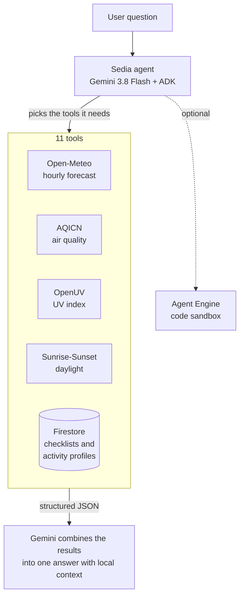

<div align="center">

# ☔ Sedia

**A Gemini agent that helps Indonesian commuters get ready for the weather.**

*Sedia* means "ready" in Indonesian, as in the saying *sedia payung sebelum hujan*: keep an umbrella ready before it rains.


</div>

---

## What it does

Ask it something like:

> *"Besok jam 7 motoran ke kantor di Jakarta, perlu bawa apa?"*
> (I'm riding my motorbike to the office in Jakarta at 7 tomorrow. What should I bring?)

Sedia checks the hourly rain forecast, air quality, UV index and sunrise time for that place. It matches them against gear checklists and activity limits stored in Firestore, then answers in plain language with local context: WIB, WITA and WIT time zones, ojol and KRL commutes, *jas hujan setelan* (a two-piece rain suit) when the rain is heavy.

It was built live at the Build with Gemini World Tour (Track 3: Agent-First Apps) in Jakarta on 21 October 2026, starting from the [workshop starter kit](https://github.com/cszhu/build-with-gemini).

## How it works



1. The message goes to one ADK agent running Gemini 3.8 Flash.
2. The model decides which tools to call.
3. Each tool calls a public API or Firestore and returns structured JSON. When input or config is missing (an unknown city, no API key), the tool returns an explicit error instead of guessing.
4. The model combines the results into one answer.

### Tools

| Tool | Source | Returns |
|---|---|---|
| `fetch_hourly_weather` | [Open-Meteo](https://open-meteo.com) | Current weather and the next 12 hours: rain probability, temperature, condition |
| `get_air_quality` | [AQICN](https://aqicn.org) | AQI, dominant pollutant, PM2.5, nearest station, Indonesian category label |
| `get_uv_index` | [OpenUV](https://www.openuv.io) | Current UV, today's peak and its time, hours with UV ≥ 6 (cached for 1 hour) |
| `fetch_daylight_and_sun_times` | [Sunrise-Sunset](https://sunrise-sunset.org/api) | Sunrise, sunset, dawn, dusk, day length |
| `get_current_time` | Python `zoneinfo` | Local time in WIB, WITA or WIT |
| `get_weather_checklist`, `list_weather_checklists`, `save_weather_checklist` | Firestore `weather_checklists` | What to bring for a given weather and commute mode |
| `get_activity_profile`, `list_activity_profiles`, `save_activity_profile` | Firestore `outdoor_activity_profiles` | AQI, rain and temperature limits for activities like morning runs, Friday prayer or futsal |

The forecast and daylight tools know 11 cities by name: Jakarta, Bandung, Surabaya, Yogyakarta, Semarang, Medan, Denpasar, Bali, Makassar, Balikpapan and Jayapura. For anywhere else they ask for latitude and longitude, and the model retries with coordinates.

### Where it runs

| Piece | Runs on |
|---|---|
| Agent | [Google ADK](https://google.github.io/adk-docs/), served by FastAPI ([`app/fast_api_app.py`](daily-weather-companion/app/fast_api_app.py)) |
| Model | Gemini 3.8 Flash on Vertex AI, or a Gemini API key |
| Deployment | Agent Runtime on Google Cloud, via `agents-cli deploy` |
| Data | Firestore collections `weather_checklists` and `outdoor_activity_profiles` |
| Code execution | Optional Agent Engine sandbox, enabled with `SANDBOX_RESOURCE_NAME` |
| Interfaces | ADK dev UI and REST/SSE API, an [A2A](https://a2a-protocol.org/) endpoint at `/a2a/app` (agent card at `/a2a/app/.well-known/agent-card.json`), and Vertex AI reasoning-engine routes |
| Telemetry | Cloud Trace, Cloud Logging and BigQuery, when enabled |

## Run it locally

You need Python 3.11 to 3.13, [uv](https://docs.astral.sh/uv/), [agents-cli](https://google.github.io/agents-cli/guide/getting-started/) (`uv tool install google-agents-cli`), and the gcloud CLI logged in with application default credentials. Your Google Cloud project needs Vertex AI and Firestore enabled.

```bash
git clone https://github.com/MogaTaufiq/buildwithgemini-daily-weather-companion.git
cd buildwithgemini-daily-weather-companion/daily-weather-companion
cp .env.example .env              # fill in the values below
agents-cli install
uv run python seed_firestore.py   # 5 gear checklists and 4 activity profiles
agents-cli playground
```

### Configuration

| Variable | Needed for | Notes |
|---|---|---|
| `GOOGLE_CLOUD_PROJECT` | Vertex AI, Firestore | Falls back to your gcloud default project when unset |
| `GOOGLE_CLOUD_LOCATION` | Vertex AI | `global` |
| `GOOGLE_GENAI_USE_VERTEXAI` | Vertex AI | `true`, or set `GEMINI_API_KEY` instead |
| `AQICN_TOKEN` | Air quality | Free token from [aqicn.org](https://aqicn.org/data-platform/token/). Without it the tool returns an error |
| `OPENUV_API_KEY` | UV index | Free key from [openuv.io](https://www.openuv.io) |
| `SANDBOX_RESOURCE_NAME` | Code execution | Optional. An existing Agent Engine sandbox; code execution stays off when unset |

### Tests

```bash
uv run pytest tests/unit          # tool behaviour, no network calls
uv run pytest tests/integration   # needs a working Google Cloud project
```

## Deploy

```bash
gcloud config set project <your-project-id>
agents-cli deploy
```

The first deployment from the workshop lived in a temporary lab project that no longer exists. [`deployment/terraform/single-project/vars/env.tfvars`](daily-weather-companion/deployment/terraform/single-project/vars/env.tfvars) still holds that lab project ID, so update it before using Terraform.

## Status

| Area | Status |
|---|---|
| Hourly forecast, air quality, UV, daylight, local time | ✅ Done |
| Gear checklists and activity profiles in Firestore | ✅ Done |
| A2A endpoint | ✅ Done |
| Code sandbox | ⚠️ Wired in, off unless configured. The commute rain-risk score is not written yet |
| Memory of the user's route, commute mode and sensitivities | ⏳ Planned |
| Proactive alerts that run without being asked | ⏳ Planned |
| BMKG warnings, RainViewer nowcast, Google Calendar, reverse geocoding | ⏳ Planned |
| A2UI cards, a "Today's Sky" image, a web frontend | ⏳ Planned |

The original plan is in [`project_brief.md`](project_brief.md).

### Known limitations

- `save_weather_checklist` and `save_activity_profile` write to shared collections, so anyone chatting with the agent can overwrite the catalog.
- When explicit coordinates are given, times come back in WIB even for WITA or WIT locations.
- The Dockerfile copies `.env` into the image. Keep secrets out of it, or move them to Secret Manager.

## Why an agent and not just Gemini?

Gemini with Google Search can already answer "will it rain in Jakarta tomorrow?". Fetching weather data alone is not a reason to build an agent.

An agent earns its place when it has at least one of these:

- Context the internet doesn't have: your route, your calendar, the street near your office that floods every rainy season
- It runs without being asked
- It can act, like moving a meeting or sending an alert
- Other apps can call it through an API or A2A

Sedia covers only the last one today. The planned items above are about the other three.

## Repository layout

```text
.
├── daily-weather-companion/       # the Sedia agent (ADK project)
│   ├── app/
│   │   ├── agent.py               # agent, instruction, tool list
│   │   ├── weather_service.py     # Open-Meteo forecast and city lookup
│   │   ├── aqicn_service.py       # AQICN air quality
│   │   ├── openuv_service.py      # OpenUV index with a 1-hour cache
│   │   ├── sun_service.py         # sunrise and sunset
│   │   ├── firestore_service.py   # checklists and activity profiles
│   │   └── fast_api_app.py        # FastAPI server, A2A and reasoning-engine routes
│   ├── tests/                     # unit, integration and eval
│   ├── deployment/terraform/      # single-project infrastructure
│   └── seed_firestore.py          # seed data for Firestore
├── .agents/                       # workshop skills and MCP config for Antigravity
├── project_brief.md               # original project brief
└── assets/
```

## Credits

Built by [Moga Taufiq Bagidya](https://github.com/MogaTaufiq) at Google's Build with Gemini World Tour (Track 3), Jakarta, from the [cszhu/build-with-gemini](https://github.com/cszhu/build-with-gemini) starter kit and its [lab guide](https://cszhu.github.io/build-with-gemini/), using [Antigravity](https://antigravity.google), [agents-cli](https://google.github.io/agents-cli/guide/getting-started/) and [ADK](https://google.github.io/adk-docs/).

Weather and environment data from Open-Meteo, the World Air Quality Index Project (AQICN), OpenUV and Sunrise-Sunset.org.

This is not an officially supported Google product. Template code generated by `agents-cli` keeps its original Apache 2.0 headers.
